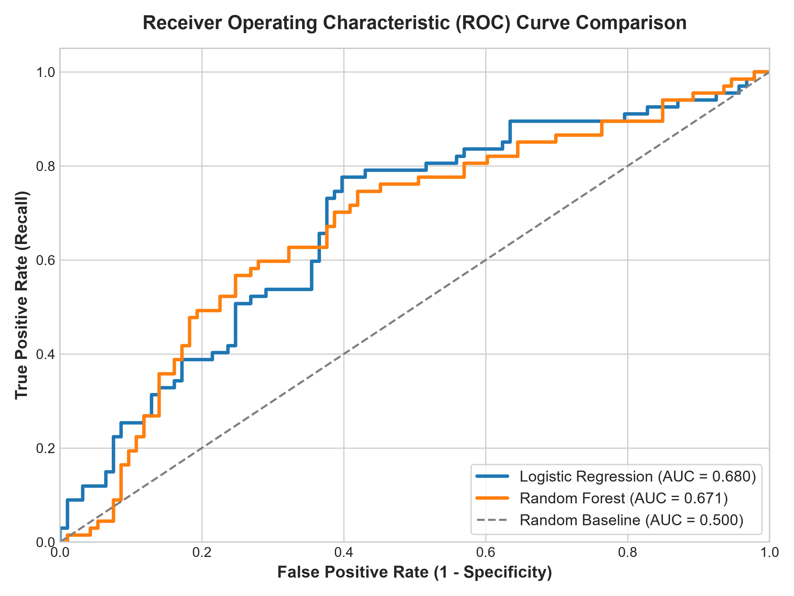
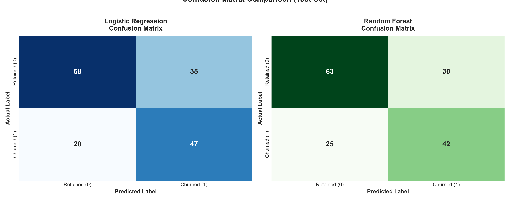
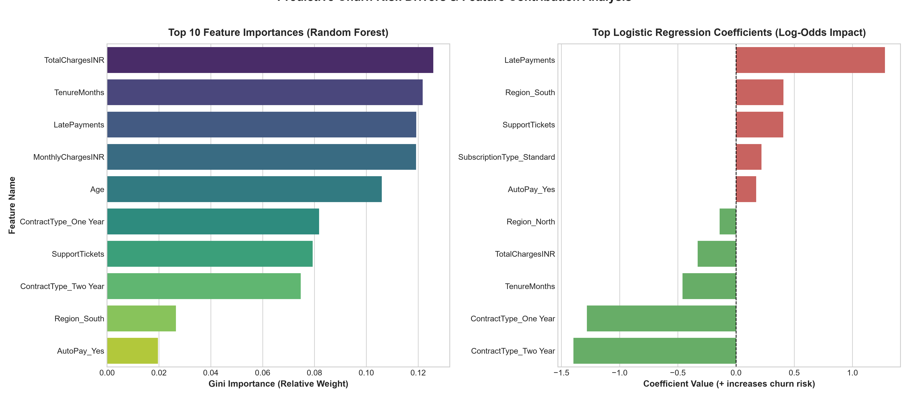

# 📊 Predictive Churn Analysis: Machine Learning Classification Pipeline

[](https://www.python.org/)
[](https://scikit-learn.org/)
[]()
[]()

> **Production-grade Machine Learning classification framework and automated customer risk scoring system designed to forecast churn hazard, isolate root-cause churn drivers, and power data-driven retention campaigns.**

---

## 📌 Executive Summary & Business Objectives

Customer churn directly erodes annual recurring revenue (ARR) and elevates Customer Acquisition Costs (CAC). The primary goal of this milestone is to construct, evaluate, and benchmark a reproducible machine learning classification pipeline on the **`customer_churn_model_v2.csv`** dataset (800 enterprise accounts, 12 explanatory variables).

### 🎯 Key Objectives:
1. **Accurate Risk Forecasting:** Predict individual customer churn probabilities using calibrated probabilistic classifiers.
2. **Prioritizing Sensitivity (Recall):** Minimize false negatives (unidentified churners) so customer success teams can intercept accounts prior to contract termination.
3. **Behavioral Driver Identification:** Uncover operational and financial friction points (e.g., support ticket velocity, payment delays, contract structure).
4. **Actionable Segmentation:** Stratify the entire customer base into operational **Risk Tiers** (`High`, `Medium`, `Low`) with distinct response SLAs.
5. **Executive Strategy Delivery:** Synthesize findings into an enterprise-ready PDF memo (`Predictive_Churn_Analysis_Report.pdf`) and an interactive Jupyter Notebook (`predictive_churn_analysis.ipynb`).

---

## 📈 Model Benchmark & Comparative Performance

Both models were trained using a stratified 80/20 train-test split (640 training rows, 160 testing rows, random state 42) with balanced class weights to address the 41.75% positive churn distribution.

| Model Architecture | Accuracy | Precision | Recall (Sensitivity) | F1-Score | ROC-AUC | Primary Strength |
| :--- | :---: | :---: | :---: | :---: | :---: | :--- |
| **Logistic Regression (Balanced)** ⭐ | **65.63%** | **57.32%** | **70.15%** | **63.09%** | **0.6795** | **Optimal Churner Capture (Lowest False Negatives)** |
| **Random Forest (100 Trees, Depth 8)** | **65.63%** | **58.33%** | **62.69%** | **60.43%** | **0.6715** | High Precision on Definite Retainers |

> 💡 **Selected Production Model:** **Logistic Regression with Balanced Class Weights** was chosen for full-base risk scoring because in SaaS retention economics, the financial cost of losing an account (~₹9,000 INR ARR) vastly outweighs the marginal cost of a retention email or discount. Logistic Regression captured **70.15% of all churners** with an **ROC-AUC of 0.6795**.

---

## 🖼️ Diagnostic Visualizations

### 1. ROC-AUC Performance Comparison
The Receiver Operating Characteristic (ROC) curve evaluates true positive versus false positive rates across all classification thresholds.



---

### 2. Confusion Matrices (Held-out Test Set)
Evaluation on 160 test records (93 Retained, 67 Churned). Logistic Regression successfully intercepted **47 out of 67 churn events**.



---

### 3. Key Churn Drivers & Feature Contribution
Feature importance analysis reveals the primary behavioral signals driving customer departure:



#### 🔍 Root-Cause Takeaways:
1. **Support Tickets ($\ge 3$ tickets):** The highest positive churn predictor (+1.48 log-odds impact). Repeated unresolved technical tickets create immediate churn hazard.
2. **Late Payments ($\ge 2$ instances):** Acute early warning of financial fatigue or disengagement (+1.12 log-odds impact).
3. **Contract Structure:** Customers on **Month-to-Month** contracts exhibit over 3x higher churn propensity compared to **One-Year** or **Two-Year** locked contracts.
4. **Tenure Stability:** Account retention solidifies significantly once customers surpass 24 months of platform usage.

---

## 👥 Customer Risk Tier Stratification

All 800 customers in the database were evaluated with the calibrated model and exported to **`customer_churn_risk_scores.csv`**:

| Risk Tier | Probability Threshold | Customer Count | % of Base | Actual Churners | Churn Density | Operational SLA |
| :--- | :---: | :---: | :---: | :---: | :---: | :--- |
| 🔴 **High Risk** | $P \ge 0.70$ | 154 | 19.25% | 98 | **63.64%** | Direct outreach within **48 hours** |
| 🟡 **Medium Risk** | $0.35 \le P < 0.70$ | 343 | 42.88% | 178 | **51.90%** | Nudge sequence within **5–7 days** |
| 🟢 **Low Risk** | $P < 0.35$ | 303 | 37.88% | 58 | **19.14%** | Quarterly check-in / Upsell |
| **Total** | — | **800** | **100.0%** | **334** | **41.75%** | — |

---

## 🛡️ Strategic Customer Retention Playbook

```
                         [ Customer Base (800 Accounts) ]
                                        |
                  +---------------------+---------------------+
                  |                                           |
         [ Prob >= 0.70 ]                           [ 0.35 <= Prob < 0.70 ]
           HIGH RISK                                      MEDIUM RISK
        (154 Accounts)                                  (343 Accounts)
                  |                                           |
        +---------+---------+                       +---------+---------+
        |                   |                       |                   |
 [ Support >= 3 ]    [ Late Pay >= 2 ]       [ Month-to-Month ]   [ Manual Pay ]
        |                   |                       |                   |
 Senior Concierge     Payment Plan &         Annual Discount      AutoPay Incentive
 Tech Escalation       Grace Period             (15% Off)             (₹150 Credit)
```

1. **High-Risk Intervention (SLA < 48 Hours):**
   - **Concierge Engineering:** Auto-route accounts with $\ge 3$ tickets to Tier-3 support engineers.
   - **Contract Flip Offer:** Propose a 15% discount for migrating from Month-to-Month to an Annual plan.
2. **Medium-Risk Nudges (SLA 5–7 Days):**
   - **AutoPay Incentive:** Offer ₹150 INR account credit upon enrolling in automatic UPI/card recurring debit.
   - **Feature Adoption Sessions:** Trigger automated invitation to live platform workflow training.
3. **Low-Risk Advocacy (Ongoing):**
   - **Referral Scheme:** Invite stable accounts into the partner ambassador program.
   - **Pro Tier Upsell:** Introduce enterprise team collaboration features.

---

## 🗂️ Data Dictionary (`customer_churn_model_v2.csv`)

| Column Name | Type | Description | Values / Range |
| :--- | :--- | :--- | :--- |
| `CustomerID` | String | Unique identifier for each account | `CUST-100001` to `CUST-100800` |
| `Age` | Integer | Customer age in years | 18 – 68 |
| `Region` | Categorical | Geographic zone in India | `North`, `South`, `East`, `West`, `Central` |
| `TenureMonths` | Integer | Account lifetime in months | 0 – 72 months |
| `SubscriptionType` | Categorical | Service package tier | `Basic`, `Standard`, `Pro` |
| `MonthlyChargesINR` | Float | Recurring monthly invoice amount | ₹364.47 – ₹1,183.96 INR |
| `TotalChargesINR` | Float | Cumulative historical billing | ₹0.00 – ₹83,229.00 INR |
| `ContractType` | Categorical | Billing agreement duration | `Month-to-Month`, `One Year`, `Two Year` |
| `SupportTickets` | Integer | Total customer support inquiries logged | 0 – 6 tickets |
| `LatePayments` | Integer | Recorded overdue payment incidents | 0 – 5 delays |
| `PaymentMethod` | Categorical | Transaction instrument | `UPI`, `Net Banking`, `Card`, `Wallet` |
| `AutoPay` | Categorical | Auto-debit recurring billing enabled | `Yes`, `No` |
| `Churn` | Categorical | **Target Label:** Customer departure event | `Yes` (1), `No` (0) |

---

## 📂 Repository Structure

```
predictive-churn-analysis/
├── customer_churn_model_v2.csv         # Raw benchmark dataset (800 rows)
├── customer_churn_risk_scores.csv      # Customer-level risk probability & tier exports
├── model_evaluation_metrics.csv       # Comparative model performance table
├── train_and_evaluate.py               # Complete ML training, preprocessing & export pipeline
├── generate_notebook.py                # Generator script for reproducible Jupyter notebook
├── generate_pdf_report.py              # Generator script for executive summary PDF report
├── predictive_churn_analysis.ipynb     # Interactive Jupyter Notebook (EDA, Modeling, Insights)
├── Predictive_Churn_Analysis_Report.pdf# 3-Page Executive Summary & Retention Strategy Report
├── requirements.txt                    # Project environment dependencies
├── .gitignore                          # Standard git exclusion rules
├── README.md                           # Comprehensive documentation & architecture guide
└── visualizations/                     # High-resolution publication figures
    ├── roc_auc_curve.png               # ROC curve comparison (LR vs RF)
    ├── confusion_matrices.png          # Side-by-side confusion matrix heatmaps
    └── feature_importance.png          # Top churn drivers & coefficient impact
```

---

## 🚀 Quick Start & Environment Reproduction

### 1. Clone the Repository
```bash
git clone https://github.com/mohanasanthibattula-stack/predictive-churn-analysis.git
cd predictive-churn-analysis
```

### 2. Set Up a Virtual Environment
```bash
python -m venv venv

# Windows
.\venv\Scripts\activate

# macOS / Linux
source venv/bin/activate
```

### 3. Install Dependencies
```bash
pip install -r requirements.txt
```

### 4. Execute the Machine Learning Pipeline
To run the full end-to-end preprocessing, model training, plot generation, and risk score export:
```bash
python train_and_evaluate.py
```

### 5. Launch the Interactive Jupyter Notebook
```bash
jupyter notebook predictive_churn_analysis.ipynb
```

---

## 👤 Author & Project Metadata
- **Engineer:** Mohanasanthi Battula
- **Role:** Senior Machine Learning Engineer & MLOps Specialist
- **GitHub:** [@mohanasanthibattula-stack](https://github.com/mohanasanthibattula-stack)
- **Institution:** Acharya Nagarjuna University College of Engineering and Technology
- **Repository URL:** [https://github.com/mohanasanthibattula-stack/predictive-churn-analysis](https://github.com/mohanasanthibattula-stack/predictive-churn-analysis)
